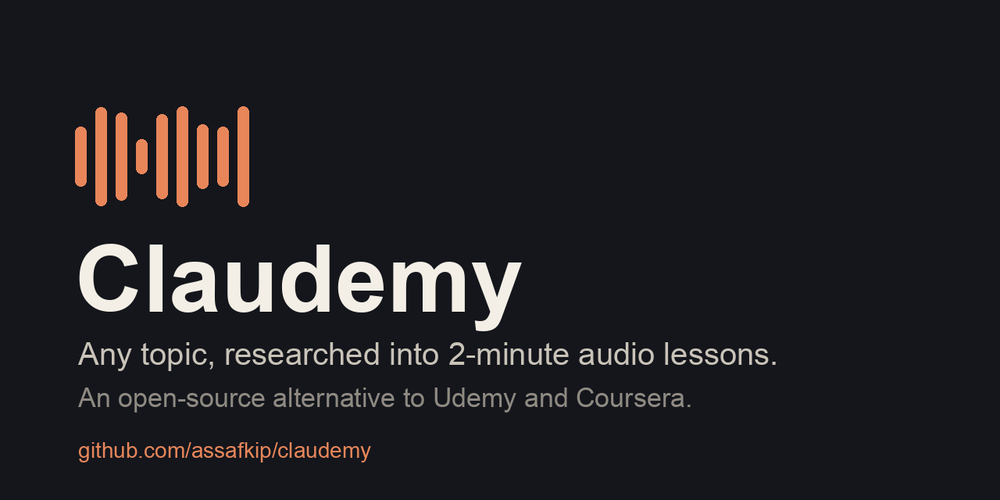

# Claudemy: an open-source alternative to Udemy and Coursera



**Claudemy is a free Claude Code skill that turns any topic into a short audio course.** You type what you want to learn. Claude researches it on the web, works out what good sources agree on, and builds a set of 2-minute lessons: two voices talking, a one-screen card, and one small thing to try. Every lesson links to the pages it came from.

```
> teach me negotiation
```

No catalog, no subscription, no 40-hour video course. Learn exactly the topic you need, at your level, in lessons short enough to finish.

## What you get
- **About 12 audio lessons, 2 minutes each.** Two hosts talking, not a lecture. MP3 files you can play anywhere.
- **A card per lesson:** the idea in three lines, how many sources agree (and who disagrees), one small practice, and links to go deeper.
- **A playbook:** one rule per lesson, collected in one file you keep.
- **A lesson plan** that shows where the experts split, laid out as decisions rather than lessons.
- **Real citations.** A checker refuses any lesson that cites a page the research didn't actually read.

## How it works
1. **Maps the topic** into sub-topics, from how it's usually taught.
2. **Researches the web:** 20 to 40 pages from practitioners, official docs, research summaries and a few dissenting views. No more than 3 pages from one site, so no single voice dominates.
3. **Reads and compares:** reader agents pull cited notes, then one agent merges them into themes with agreement counts.
4. **Plans the course** in arcs of about 4 lessons, foundations first.
5. **Makes one sample lesson** and waits for your reaction, then writes and records the rest.

Want a class built from one person's work instead? Say so: `teach me negotiation from <name>'s writing`. It reads their Substack or blog and builds the class from that.

## Install
As a Claude Code plugin:
```
/plugin marketplace add assafkip/claudemy
/plugin install claudemy@claudemy
```
Or copy `skills/claudemy/` into `~/.claude/skills/`, or download [`dist/claudemy.skill`](dist/claudemy.skill).

## Needs
- [Claude Code](https://claude.com/claude-code) with web search.
- Python 3 with `beautifulsoup4` (`pip install beautifulsoup4`), and `ffmpeg`.
- Audio: an ElevenLabs API key in `ELEVENLABS_API_KEY` for natural two-voice lessons. Without one, macOS's built-in voices are used (free, plainer).
- Optional: `pandoc` for a Word copy of the cards.

Voices can be changed with `CLAUDEMY_VOICE_A` / `CLAUDEMY_VOICE_B` (ElevenLabs voice ids) or `CLAUDEMY_SAY_A` / `CLAUDEMY_SAY_B` (macOS voices).

## FAQ

**Is Claudemy free?**
Yes. The skill is MIT licensed. You pay only for what you already use: your Claude plan, and ElevenLabs credits if you want the premium voices. The macOS voices cost nothing.

**How is it different from Udemy or Coursera?**
Course sites sell a fixed course someone recorded once. Claudemy builds a course on the topic you name, at your level, from current sources, and shows you where those sources disagree. Lessons are 2 minutes and end in one thing to try, so the course is built to be finished.

**What topics does it work for?**
Anything people write about well on the open web: skills (negotiation, public speaking, sourdough), professional topics (pricing, hiring, SQL), and subjects (stoicism, music theory). Health, legal and financial topics get a note where advice depends on your situation.

**Does it copy other people's content?**
No. It reads pages the way a researcher does, writes its own lessons, and links to the sources. Pages it reads are saved only in your local workspace for your own study.

**Can I use it without ElevenLabs?**
Yes. On a Mac it falls back to the built-in voices. The cards and playbook work with no audio at all.

**How long does a course take to make?**
A 12-lesson course is a long-running Claude Code session: research, reading, writing and about 25 minutes of generated audio.

**Can I learn from one specific expert?**
Yes. Name them in the request. Claudemy finds their Substack or blog and builds the course from their writing.

## Who built it
Built by Assaf Kipnis. More of my work: [askconsulting.io](https://askconsulting.io)

## License
MIT. Free to use, change and share.
